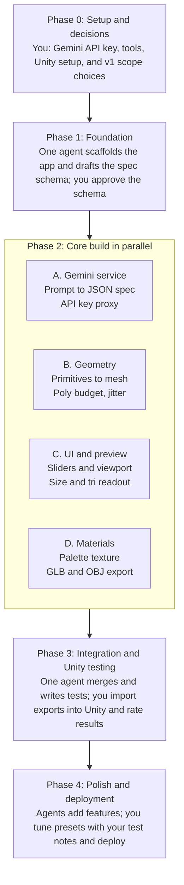

# 3D Asset Generator: Implementation Plan
 
October 7, 2026 · Susan
 
## How to read this plan
 
The build has five phases, and parallel agents are most useful in Phase 2, where four parts of the app can be built at the same time. Every task has one of three owner labels:
 
- **Agent:** a coding agent can complete it from a written task description.
- **You:** it needs your accounts, your Mac with Unity, or your judgment on quality and style.
- **Together:** an agent drafts it and you review before work continues.
The four Phase 2 agents can work without waiting on each other because they all follow one shared JSON spec, which is written and approved in Phase 1.
 

 
Phases run top to bottom; only the four tracks inside Phase 2 run side by side.
 
## Phase 0: Setup and decisions
 
Every task in this phase needs your accounts or your decisions, so agents start only after it is done. Most of it fits in one sitting.
 
| Task | Owner | Notes |
| --- | --- | --- |
| Create a Gemini API key in Google AI Studio and set a spending limit | You | Needs your Google account |
| Install Node.js, Git, and a code editor such as VS Code | You | All run on a MacBook Air |
| Install the glTFast package in your Unity project | You | Needed to import GLB files |
| Create a GitHub repository for the project | You | Each agent works in its own branch of this repo |
| Choose the v1 scope: props only or more asset types, palette texture or vertex colors, GLB and OBJ export, URP or Built-in render pipeline | You | These choices go into the Phase 1 schema |
| Collect 10 to 15 test prompts with reference images of the style you want | You | Used to judge output quality in Phase 3 |
 
## Phase 1: Foundation
 
One agent works alone in this phase, because every later task depends on the spec schema written here. The phase is done when you approve the schema and all five sample files pass validation.
 
| Task | Owner | Notes |
| --- | --- | --- |
| Scaffold the app with Vite, React, and TypeScript, with folder structure and linting | Agent | |
| Draft the asset spec schema in Zod: a parts list (primitive type, size, position, rotation, segment count, palette index), the palette, the pivot, and the asset type | Agent | This schema is the contract every Phase 2 track follows |
| Review the schema against your Phase 0 scope choices and approve it | You | Ask for changes now, since later changes affect all four tracks |
| Write five sample spec files by hand (crate, mug, tree, lamp, rock) | Agent | Test data for Phase 2, so tracks can work without calling Gemini |
 
## Phase 2: Core build in parallel
 
Four agents can work at the same time here, one per track. Each track builds against the approved schema and the sample files, so no track waits on another.
 
| Track | What the agent builds | Your part |
| --- | --- | --- |
| A. Gemini service | System prompt; structured JSON output matched to the schema; a retry when output fails validation; a serverless function that holds the API key; slider values passed into the prompt | Try prompts and judge whether results match your style |
| B. Geometry builder | One builder per primitive, with segment counts set by the detail slider; merging parts into one mesh; flat shading; seeded vertex jitter; pivot placement; triangle count and budget limit | None until Phase 3 |
| C. UI and preview | Prompt box; slider panel (asset type, detail, platform preset, roundness, jitter, palette, seed, material mode); 3D viewport with orbit controls; triangle count and file size readout | Visual design of the interface |
| D. Materials and export | 64×64 palette texture; UVs mapped to palette cells; vertex color option; GLB export; OBJ, MTL, and PNG bundled as a zip; Unity scale, axis, and named part hierarchy | None until Phase 3 |
 
Track B carries the most weight, since it decides how good the models look. If you run only two agents, start with B and D, because neither needs the API key and both can be tested with the sample files.
 
## Phase 3: Integration and Unity testing
 
This phase needs you most, because only you can open Unity on your Mac and judge the results. One agent merges the work first, then you and the agent test at the same time.
 
| Task | Owner | Notes |
| --- | --- | --- |
| Merge the four tracks one at a time and connect prompt, spec, mesh, preview, and export | Agent | Must finish before the rest of this phase |
| Write automated tests: schema validation, triangle counts under budget, exported GLB files reload in three.js | Agent | Runs in parallel with your testing |
| Import exports into Unity and check scale, pivot, orientation, material colors, and texture filter set to Point | You | |
| Run your 10 to 15 test prompts and rate each result | You | Note what looks wrong, not only what fails |
| Turn problems into a checklist; the agent fixes them and you recheck in Unity | Together | Repeat until the checklist is clear |
 
## Phase 4: Polish and deployment
 
Agents can take most of this phase in parallel, while you handle the presets and the deployment accounts.
 
| Task | Owner | Notes |
| --- | --- | --- |
| Tune the platform presets (Mobile, Desktop, Hero) using your Phase 3 notes | Together | |
| Add prompt history, regenerate with the same seed, and batch variations | Agent | Can run in parallel with the next three tasks |
| Write error messages and loading text | Together | Agent drafts, you edit |
| Add a request limit so a public link cannot run up your API bill | Agent | |
| Deploy to Vercel or Netlify and add your API key as an environment variable | You | Needs your hosting account |
 
## Rules for running agents in parallel
 
These four rules keep parallel agents from overwriting each other's work.
 
1. Give each agent one track, its own branch, and its own folder, such as `src/gemini`, `src/geometry`, `src/ui`, and `src/export`.
2. Agents may read the schema file but not edit it. Any change goes through you, and every track updates after the change.
3. Each task brief should include the track goal, the schema file, the sample specs, and a clear finish condition, for example "all five samples build without errors and export as GLB."
4. Merge one track at a time in Phase 3, starting with B, then D, A, and C, so each merge can be tested before the next.
 